# Parte 1 Configuración inicial

Abrimos una consola y ejecutamos los siguientes comandos para inicializar el sistema de git. Básicamente estamos estableciendo el usuario que firma los commits.

Si hacemos estos comandos en nuestro home nos valdrá para todas las subcarpetas que vayamos generando.

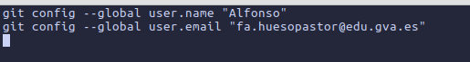  

# Generación de token en Github

Nos desplazamos a la siguiente URL
[Personal Access Tokens (Classic)](https://github.com/settings/tokens)

  

Generamos un token nuevo de tipo clásico

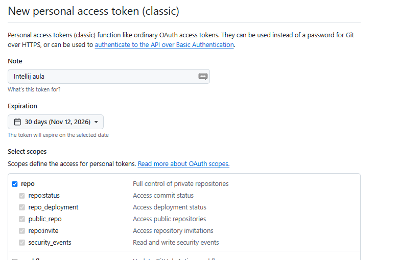  

En la captura se especifica una duración del token de un mes, es posible establecer una duración superior. Procedemos a genera el token.

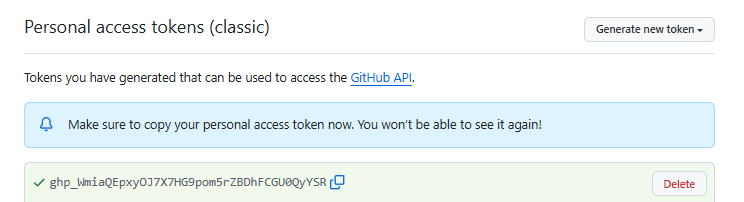  

Copiamos el contenido del token y no lo compartimos con nadie. Nos vamos a configurar este token en IntelliJ. Cuando se nos caduque el token, pasados los 30 días podremos repetir este proceso.

Accedemos a las Settings de IntelliJ

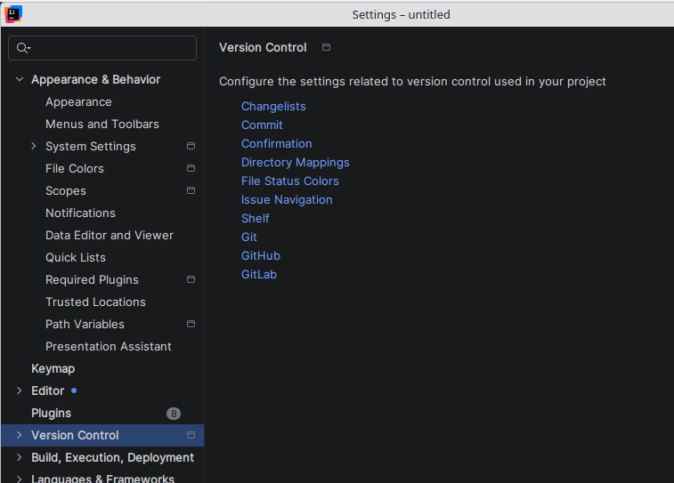  

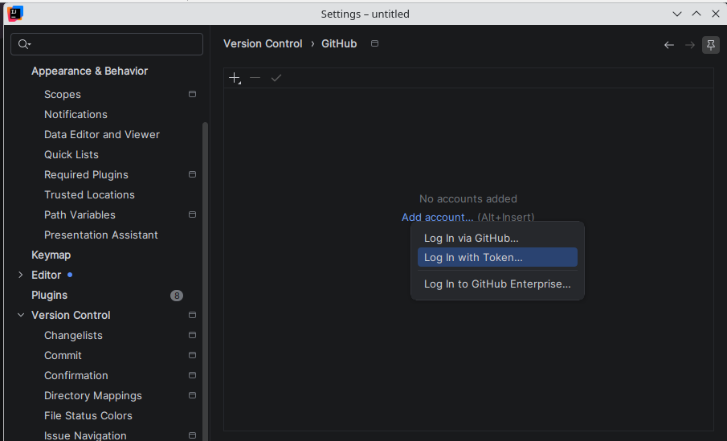  

Introducimos el token, y debe registrar nuestra propia cuenta de github:

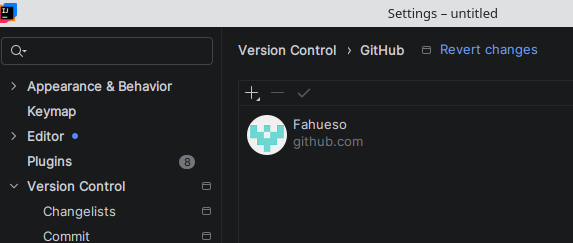  

Buscamos la opción de compartir el proyecto en GitHub (el menú puede variar en función de la versión de IntelliJ)

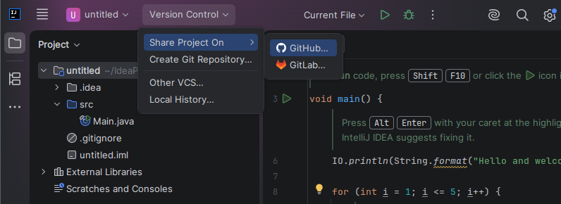  

Ponemos nombre al repositorio remoto:

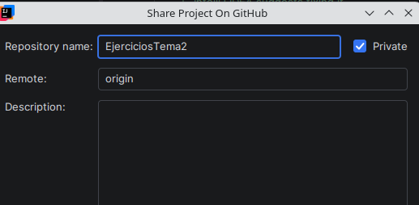  

Añadimos todos los ficheros y escribimos el mensaje correspondiente:

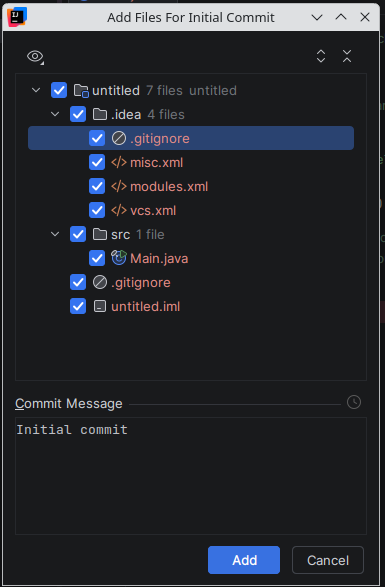  

Podemos comprobar en el navegador el repositorio desde la web de github o pulsando el enlace:

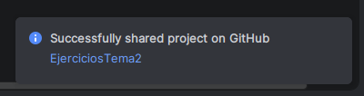  

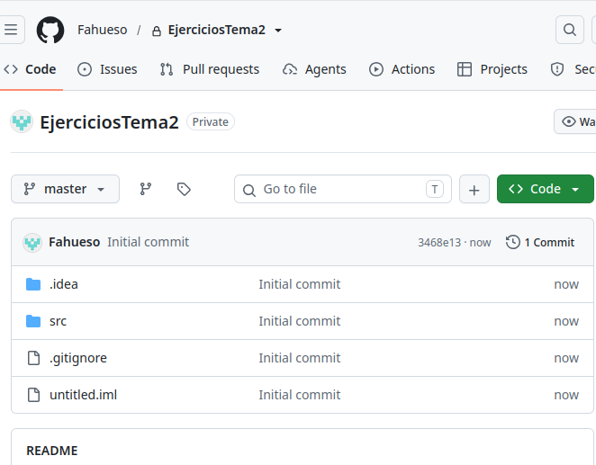  

# Parte 2: Adicción de cambios

Los ficheros que vaya modificando aparecerán marcados:

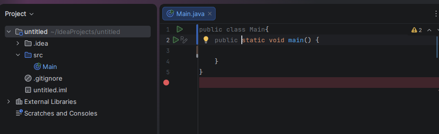  

Buscamos el botón de commit y marcamos los archivos nuevos que queramos guardar en la nube:

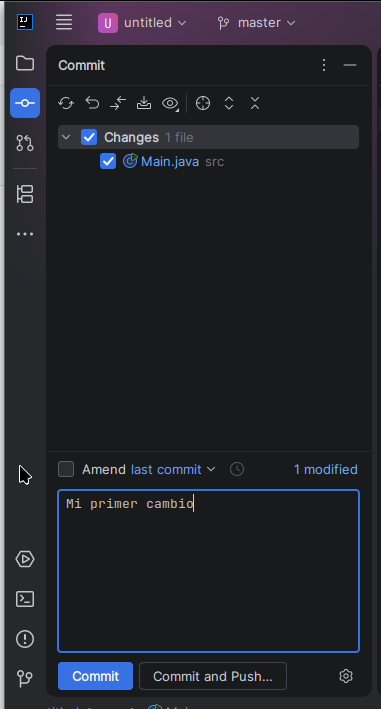  

y pulsamos la opción Commit and Push e si tenemos algún mensaje de alerta (se produce porque hay warnings en el código expuesto), podemos hacer el commit o revisar el código.

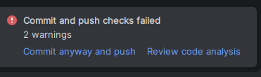  

Por último, una vez que el commit se ha realizado nos pedirá hacer el push:

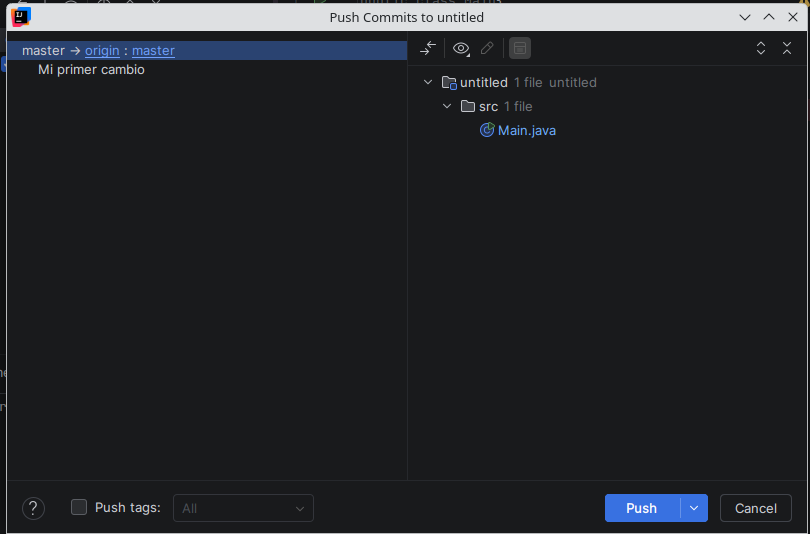  

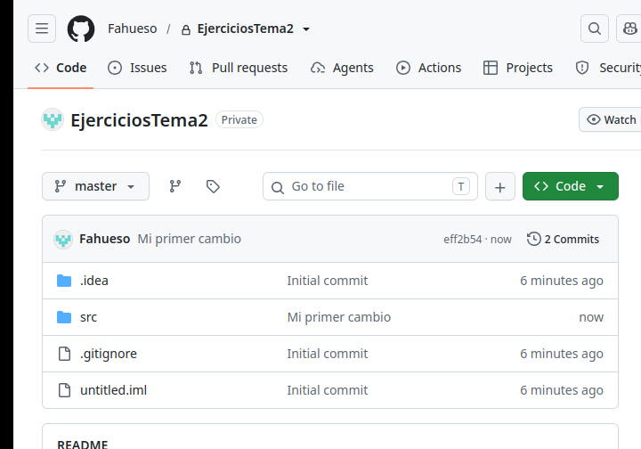  

En función de la versión de IntelliJ y del idioma podemos encontrarnos esta otra forma:

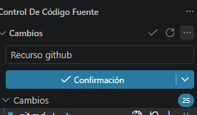  

Aqui buscaremos la opción  de Hacer commit e insertar.

# Parte 3: Poner mi repositorio en otro IntelliJ

En primer lugar nos aseguramos que nuestra cuenta está registrada en ese IntelliJ, en caso contrario tendremos que darlo de alta mediante un token (puede ser el mismo si lo hemos conservado)

En github tomamos la url:

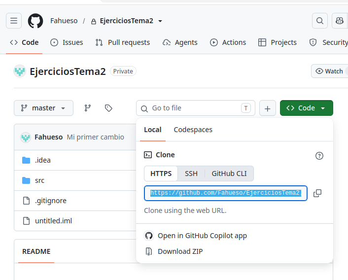  

En la pantalla inicial de IntelliJ, usando Clone Repository:

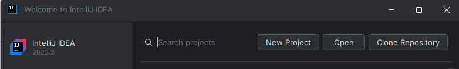  

O bien desde el menú:

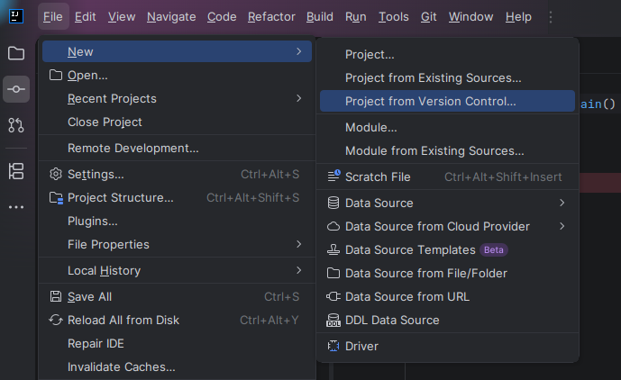  

Copiamos la URL:

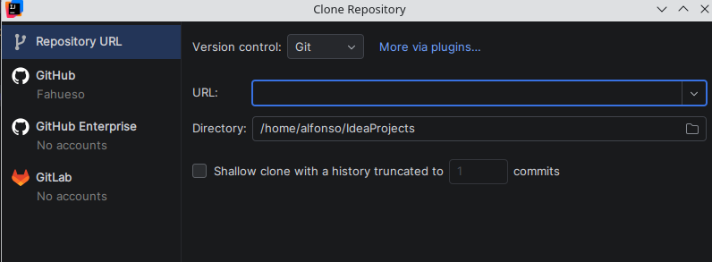  

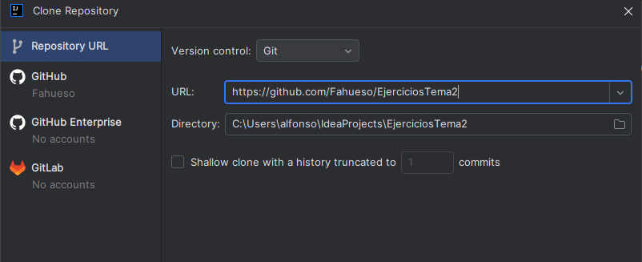  

Si el repositorio es nuestro, podemos buscarlo alternativamente en este otro apartado:

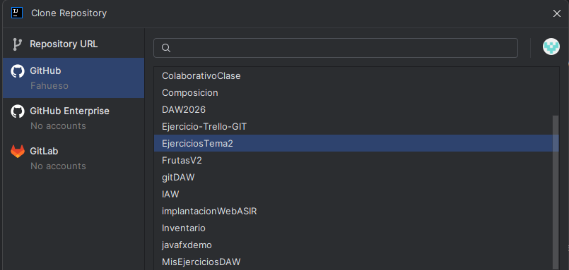  
